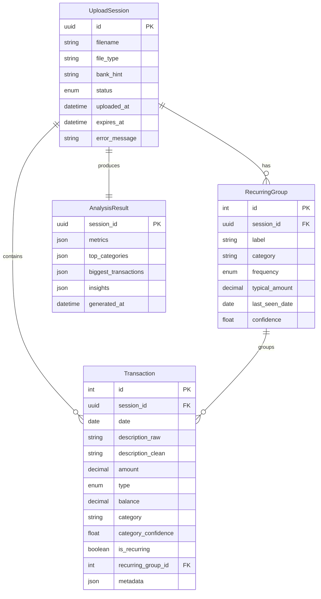

# RupeeRadar — System Architecture

This document describes the technical architecture for RupeeRadar, an AI-powered personal finance assistant. It is derived from [context.md](file:///d:/Rupee_Radar/docs/context.md) and defines how raw bank statement data flows through the system to produce categorized transactions, recurring-payment detection, financial metrics, and human-readable insights.

---

## 1. Architectural Goals

| Goal | Rationale |
|------|-----------|
| **End-to-end workflow** | Upload → insights must work as a single, uninterrupted user journey |
| **Messy-data tolerance** | Indian bank/UPI descriptions vary widely; normalization is a first-class concern |
| **Privacy by design** | Financial data is sensitive; minimize exposure and retention at every layer |
| **Prototype-first** | Ship a working vertical slice before supporting every bank format |
| **Inspectable output** | Users should see cleaned data, not just a black-box summary |
| **Extensible parsing** | New bank formats plug in without rewriting the core pipeline |

---

## 2. High-Level System View

RupeeRadar is organized as a **pipeline-oriented, modular monolith** for the prototype phase. A single application hosts ingestion, processing, analytics, and presentation. This keeps deployment simple while preserving clear module boundaries for future extraction into services.

### 2.1 System Flow Diagram

```
┌──────────────────────────────────────────────────────────────────────────────┐
│                              USER (Browser)                                  │
│  ┌────────────┐  ┌──────────────┐  ┌──────────┐  ┌──────────┐  ┌────────┐  │
│  │ File Upload │→ │ Processing   │→ │ Dashboard │→ │ Insights │→ │ Export │  │
│  │ (Drag/Drop)│  │ Status View  │  │ (Charts) │  │ Panel    │  │ Report │  │
│  └────────────┘  └──────────────┘  └──────────┘  └──────────┘  └────────┘  │
└────────────────────────────┬─────────────────────────────────────────────────┘
                             │ HTTPS (REST API)
┌────────────────────────────▼─────────────────────────────────────────────────┐
│                         BACKEND (FastAPI)                                     │
│  ┌─────────┐  ┌─────────┐  ┌───────────┐  ┌───────────┐  ┌──────────────┐  │
│  │ Ingest  │→ │ Parse & │→ │ Categorize│→ │ Recurring │→ │ Metrics &    │  │
│  │ & Store │  │ Clean   │  │ (AI/Rules)│  │ Detect    │  │ Insights Gen │  │
│  └─────────┘  └─────────┘  └─────┬─────┘  └───────────┘  └──────────────┘  │
│                                   │                                          │
│                           ┌───────▼───────┐                                  │
│                           │ Groq LLM API  │                                  │
│                           │ (External)    │                                  │
│                           └───────────────┘                                  │
└────────────────────────────┬─────────────────────────────────────────────────┘
                             │
                    ┌────────▼────────┐
                    │   SQLite / DB   │
                    │  (Local Store)  │
                    └─────────────────┘
```

### 2.2 Technology Stack

| Layer | Choice | Rationale |
|-------|--------|-----------|
| **Frontend** | React + TypeScript + Tailwind CSS | Component-driven UI, strong typing, rapid styling |
| **Backend** | Python FastAPI | Async-capable, auto-generated OpenAPI docs, strong ecosystem for data processing |
| **Database** | SQLite (local) → PostgreSQL (deployed) | Zero-config locally; production-grade when deployed |
| **File Parsing** | pandas + bank-specific parsers | Best-in-class tabular data manipulation for Python |
| **AI Categorization** | **Groq** LLM API with structured JSON output | Fast inference, cost-effective; rule engine as primary with LLM fallback |
| **Charts** | Recharts or Chart.js | Declarative, React-friendly charting with good defaults |
| **Report Export** | HTML → PDF (weasyprint / browser print) | Server-side or client-side rendering flexibility |
| **Deployment** | Docker + single VM / Railway / Render | Single-container simplicity for prototype |

---

## 3. Core Domain Model

### 3.1 Entity Relationship Diagram



### 3.2 Entity Definitions

#### UploadSession
Represents a single file upload and its processing lifecycle.

```
UploadSession
├── id (UUID)                  # Unique session identifier
├── filename                   # Original uploaded filename
├── file_type                  # csv | xlsx | pdf
├── bank_hint (optional)       # User-provided or auto-detected bank name
├── status                     # pending | parsing | processing | ready | failed
├── uploaded_at                # Timestamp of upload
├── expires_at                 # TTL for automatic privacy purge
└── error_message              # Human-readable error if status = failed
```

#### Transaction (cleaned, structured)
A single financial transaction, normalized from raw statement data.

```
Transaction
├── id                         # Auto-increment primary key
├── session_id (FK)            # Links to UploadSession
├── date                       # Transaction date (ISO 8601)
├── description_raw            # Original text from bank statement
├── description_clean          # Normalized merchant / description
├── amount                     # Signed: + credit, − debit
├── type                       # credit | debit
├── balance (optional)         # Running balance if available
├── category                   # Food | Travel | Shopping | ... | Other
├── category_confidence        # 0.0–1.0 confidence score
├── is_recurring               # Boolean flag
├── recurring_group_id (FK)    # Links related recurring transactions
└── metadata (JSON)            # UPI ref, payment mode, parser hints
```

#### RecurringGroup
Groups related recurring transactions (subscriptions, EMIs, SIPs, etc.).

```
RecurringGroup
├── id                         # Auto-increment primary key
├── session_id (FK)            # Links to UploadSession
├── label                      # e.g. "Netflix", "Home Loan EMI"
├── category                   # Inherited or overridden category
├── frequency                  # weekly | monthly | quarterly | yearly | unknown
├── typical_amount             # Median/average amount in group
├── last_seen_date             # Most recent transaction date
├── transaction_ids[]          # List of linked transaction IDs
└── confidence                 # Detection confidence score
```

#### AnalysisResult
Aggregated metrics and insights for a session.

```
AnalysisResult
├── session_id (PK/FK)         # One-to-one with UploadSession
├── metrics (JSON)             # income, spend, savings, savings_rate, etc.
├── top_categories[]           # Category totals, sorted descending
├── biggest_transactions[]     # Largest debits (and optionally credits)
├── insights[]                 # Array of human-readable insight strings
└── generated_at               # Timestamp of generation
```

### 3.3 Canonical Transaction Schema

All parsers **must** emit this normalized shape before downstream processing:

```json
{
  "date": "2025-06-01",
  "description_raw": "UPI-SWIGGY-BANGALORE-123456",
  "amount": -450.00,
  "type": "debit",
  "balance": 12500.00
}
```

**Normalization rules:**
- **Dates** → ISO 8601 (`YYYY-MM-DD`)
- **Amounts** → decimal, INR, debits are **negative** (simplifies summing)
- **Descriptions** → trimmed; always preserve `description_raw` for audit trail
- **Duplicates** → detect via `(date, amount, description_raw)` hash within a session

### 3.4 Category Taxonomy

Fixed enum aligned with [context.md §5](file:///d:/Rupee_Radar/docs/context.md#L56):

```
Food · Travel · Shopping · Bills · EMI · Subscriptions · Salary · Rent · Investments · Other
```

- `Salary` and `Investments` are typically **credits**; the rest are primarily **debits**.
- `Other` is the **fallback** when confidence is below threshold (< 0.6).

---

## 4. Processing Pipeline

The pipeline runs **synchronously** for small statements (< ~2,000 rows) and can move to a background job queue for larger files.

```
┌──────────┐   ┌──────────┐   ┌────────────┐   ┌───────────┐   ┌──────────┐
│  Stage 1 │──▶│  Stage 2 │──▶│   Stage 3  │──▶│  Stage 4  │──▶│  Stage 5 │
│  Upload  │   │  Parse & │   │ Categorize │   │ Recurring │   │ Metrics &│
│  & Store │   │  Clean   │   │ (AI/Rules) │   │  Detect   │   │Aggregates│
└──────────┘   └──────────┘   └────────────┘   └───────────┘   └────┬─────┘
                                                                      │
                          ┌──────────┐   ┌──────────┐   ┌─────────────▼──────┐
                          │  Stage 7 │◀──│  Stage 6 │◀──│                    │
                          │Dashboard │   │ Insights │   │                    │
                          │ & Report │   │ Generator│   │                    │
                          └──────────┘   └──────────┘   └────────────────────┘
```

### 4.1 Stage 1 — Ingestion & File Storage

**Responsibility:** Accept uploaded files, validate, and store temporarily for parsing.

| Input Format | Parser Strategy |
|--------------|-----------------|
| CSV          | Column mapping via header detection + heuristics |
| Excel (.xlsx)| Same as CSV; handle merged cells |
| PDF          | Table extraction (pdfplumber); bank-specific templates |

**Parser interface (plugin pattern):**

```python
from typing import Protocol

class StatementParser(Protocol):
    """All bank-specific parsers implement this interface."""
    
    def can_parse(self, file: UploadFile) -> bool:
        """Return True if this parser can handle the given file."""
        ...
    
    def parse(self, file: UploadFile) -> list[RawTransaction]:
        """Extract raw transaction rows from the file."""
        ...
```

**Prototype scope:**
- Support 1–2 common Indian bank CSV exports (e.g. HDFC, ICICI, SBI).
- Generic CSV mapper with user column-mapping as fallback.

**Validation rules:**
- Reject empty files with clear error message
- Reject password-protected PDFs with clear error message
- Enforce max file size: **10 MB**
- Log parse warnings (skipped rows, ambiguous dates) for UI display

### 4.2 Stage 2 — Cleaning & Normalization

**Responsibility:** Turn messy descriptions into structured, comparable text.

| Step | Example | Output |
|------|---------|--------|
| Strip noise | `UPI/DR/123456/SWIGGY` → `SWIGGY` | Cleaned description |
| Merchant extraction | Regex + known-merchant dictionary (Swiggy, Zomato, Amazon…) | Merchant name |
| Mode detection | UPI, NEFT, IMPS, card, cash | `payment_mode` field |
| Amount sign correction | Ensure debits/credits align with statement conventions | Correct sign |
| Date repair | Handle `DD-MM-YYYY` vs `DD/MM/YY` vs `YYYY-MM-DD` | ISO 8601 date |

**Output fields:** `description_clean`, optional `merchant`, `payment_mode`.

> Cleaning is **largely deterministic** (rules + dictionary). This improves categorization accuracy and keeps LLM calls smaller and cheaper.

### 4.3 Stage 3 — Categorization

**Responsibility:** Assign each transaction to the category taxonomy.

**Hybrid approach (4 tiers):**

```
┌─────────────────────────────────────────┐
│  1. Rule Engine (fast, high precision)  │
│     Known patterns → direct category    │
└──────────────┬──────────────────────────┘
               │ unmatched
┌──────────────▼──────────────────────────┐
│  2. Merchant Dictionary Lookup          │
│     Curated Indian merchant → category  │
└──────────────┬──────────────────────────┘
               │ still unmatched
┌──────────────▼──────────────────────────┐
│  3. LLM Batch Categorization (Groq)    │
│     Structured JSON output + confidence │
└──────────────┬──────────────────────────┘
               │ low confidence (< 0.6)
┌──────────────▼──────────────────────────┐
│  4. Default → "Other"                  │
│     Flagged for optional user review    │
└─────────────────────────────────────────┘
```

**Rule engine examples:**

| Pattern | Category |
|---------|----------|
| `SALARY`, `NEFT CREDIT SALARY` | Salary |
| `NETFLIX`, `SPOTIFY`, `YOUTUBE PREMIUM` | Subscriptions |
| `SWIGGY`, `ZOMATO`, `DOMINOS`, `MCDONALD` | Food |
| `UBER`, `OLA`, `IRCTC`, `MAKEMYTRIP` | Travel |
| `SIP`, `ZERODHA`, `GROWW`, `MUTUAL FUND` | Investments |
| `HOME LOAN`, `EMI`, `BAJAJ FINSERV` | EMI |
| `ELECTRICITY`, `AIRTEL`, `JIO`, `GAS` | Bills |
| `AMAZON`, `FLIPKART`, `MYNTRA` | Shopping |

**LLM prompt design (Groq):**
- Batch transactions (20–50 per call) with `description_clean`, `amount`, `type`
- Request structured JSON response:
  ```json
  [
    { "id": "txn_001", "category": "Food", "confidence": 0.92 },
    { "id": "txn_002", "category": "Shopping", "confidence": 0.78 }
  ]
  ```
- Include few-shot examples for Indian UPI-style strings
- **Never send** account numbers or full raw statements

**Confidence threshold:** < 0.6 → `Other`, flagged for user review in UI.

### 4.4 Stage 4 — Recurring Payment Detection

**Responsibility:** Identify subscriptions, EMIs, rent, SIPs, insurance.

**Heuristic algorithm:**

```
Step 1: Group debits by similar description_clean
        ├── Fuzzy match (Levenshtein distance or token overlap)
        └── Normalize merchant names first

Step 2: Within each group, check:
        ├── ≥ 2 occurrences
        ├── Amount within tolerance (±5% or ±₹50)
        └── Intervals consistent with cadence:
            ├── Weekly:    ~6–8 days
            ├── Monthly:   ~28–32 days
            ├── Quarterly: ~88–95 days
            └── Yearly:    ~360–370 days

Step 3: Label group from merchant name or dominant keyword

Step 4: Override category if pattern matches known recurring types
        (EMI → EMI, SIP → Investments, etc.)
```

**Output:** `RecurringGroup` records + `is_recurring` flags on individual transactions.

### 4.5 Stage 5 — Metrics & Aggregations

**Responsibility:** Compute summary numbers for the dashboard and insight generation.

| Metric | Definition |
|--------|------------|
| Total Income | `SUM(amount) WHERE type = 'credit'` |
| Total Spend | `ABS(SUM(amount)) WHERE type = 'debit'` |
| Savings | `Income − Spend` |
| Savings Rate | `(Savings / Income) × 100` |
| Top Categories | Debit totals grouped by `category`, sorted descending |
| Biggest Transaction | Single largest debit (and optionally credit) |
| Monthly Spend | Debits grouped by calendar month |
| Recurring Total | `SUM(typical_amount)` from recurring groups |

**Time scope:** Default to full statement range; UI filter for "this month" based on latest transaction date or user selection.

### 4.6 Stage 6 — Insight Generation

**Responsibility:** Produce ≥ 3 personalized, human-readable insights using real amounts.

#### Tier 1 — Template Insights (deterministic, always available)

```python
INSIGHT_TEMPLATES = [
    "You spent ₹{amount} on {category} this month — your largest category.",
    "Your biggest transaction was ₹{amount} to {merchant} on {date}.",
    "We detected {count} recurring payments totalling ₹{total}/month.",
    "Your savings rate is {rate}% — you saved ₹{savings} this period.",
    "You made {count} transactions averaging ₹{avg} each.",
]
```

#### Tier 2 — LLM-Enhanced Insights (via Groq)

- Feed **metrics + top categories + recurring summary** (not raw PII) to Groq
- Generate 2–3 narrative observations (spending trends, category shifts, anomalies)
- Prompt structure:
  ```
  Given the following spending summary for an Indian professional:
  - Total income: ₹{income}
  - Total spend: ₹{spend}
  - Top categories: {categories_with_amounts}
  - Recurring payments: {recurring_summary}
  
  Generate 2-3 brief, actionable financial insights.
  ```

> Insights **must cite actual transaction amounts** per requirements.

### 4.7 Stage 7 — Presentation & Export

**Dashboard views:**

| View | Content |
|------|---------|
| Summary Cards | Income, spend, savings, savings rate |
| Category Breakdown | Pie / donut / bar chart by category |
| Monthly Trend | Line / bar chart of spend over time |
| Transaction Table | Sortable, filterable, with category badges |
| Recurring Panel | List of detected subscriptions/EMIs with amounts and frequency |
| Insights Panel | ≥ 3 insight cards with context |

**Report export options:**
- HTML report rendered server-side or client-side
- PDF via print stylesheet or weasyprint
- Shareable summary (screenshot-friendly single page)

---

## 5. API Design

RESTful API under `/api/v1`. All endpoints scoped to an `UploadSession`.

### 5.1 Endpoint Reference

| Method | Endpoint | Description | Response |
|--------|----------|-------------|----------|
| `POST` | `/upload` | Upload statement file (multipart) | `202 { session_id, status }` |
| `GET` | `/sessions/{id}` | Session status and metadata | `200 UploadSession` |
| `GET` | `/sessions/{id}/transactions` | Paginated cleaned transactions | `200 { data[], total, page }` |
| `PATCH` | `/sessions/{id}/transactions/{txn_id}` | User override category | `200 Transaction` |
| `GET` | `/sessions/{id}/recurring` | Detected recurring groups | `200 RecurringGroup[]` |
| `GET` | `/sessions/{id}/analytics` | Metrics and aggregations | `200 AnalysisResult` |
| `GET` | `/sessions/{id}/insights` | Generated insights | `200 { insights[] }` |
| `GET` | `/sessions/{id}/report` | Downloadable report (HTML/PDF) | `200 file` |
| `DELETE` | `/sessions/{id}` | Purge all session data | `204 No Content` |

### 5.2 Upload Flow

```
Client                              Server
  │                                    │
  │  POST /upload (multipart file)     │
  │───────────────────────────────────▶│
  │                                    ├── Validate file type & size
  │  202 { session_id, status:         │ ├── Store file temporarily
  │        "processing" }              │ ├── Begin pipeline (sync for small files)
  │◀───────────────────────────────────│
  │                                    │
  │  GET /sessions/{id}  (poll)        │
  │───────────────────────────────────▶│
  │  200 { status: "ready" }           │
  │◀───────────────────────────────────│
  │                                    │
  │  GET /sessions/{id}/transactions   │
  │  GET /sessions/{id}/analytics      │  ← Parallel fetches
  │  GET /sessions/{id}/insights       │
  │───────────────────────────────────▶│
  │  200 (data for each)               │
  │◀───────────────────────────────────│
```

> For prototype simplicity, processing can be **synchronous** with a loading spinner for small files (< 2,000 rows).

### 5.3 Request/Response Examples

**Upload:**
```http
POST /api/v1/upload
Content-Type: multipart/form-data

file: statement.csv
bank_hint: "hdfc" (optional)
```

**Response:**
```json
{
  "session_id": "a1b2c3d4-e5f6-7890-abcd-ef1234567890",
  "status": "processing",
  "message": "File uploaded successfully. Processing 342 transactions..."
}
```

**Analytics:**
```json
{
  "session_id": "a1b2c3d4-...",
  "metrics": {
    "total_income": 125000.00,
    "total_spend": 87500.00,
    "savings": 37500.00,
    "savings_rate": 30.0,
    "transaction_count": 342,
    "date_range": { "from": "2025-01-01", "to": "2025-06-30" }
  },
  "top_categories": [
    { "category": "Food", "total": 18500.00, "percentage": 21.1 },
    { "category": "Rent", "total": 15000.00, "percentage": 17.1 },
    { "category": "EMI", "total": 12000.00, "percentage": 13.7 }
  ],
  "biggest_transactions": [
    { "amount": -15000.00, "description": "Rent Payment", "date": "2025-06-01" }
  ]
}
```

---

## 6. Frontend Architecture

### 6.1 Page Structure & Routing

```
/                         → Landing page + file upload
/analysis/:sessionId      → Main dashboard (tabs or scrollable sections)
  ├── Summary             → Overview cards (income, spend, savings)
  ├── Transactions        → Searchable, filterable table
  ├── Recurring           → Detected subscription/EMI cards
  ├── Insights            → Personalized insight cards
  └── Export              → Report download / print
```

### 6.2 State Management

| State Type | Strategy | Examples |
|------------|----------|----------|
| **Server state** | React Query / TanStack Query | Transactions, analytics, insights (auto-cached, refetchable) |
| **UI state** | Local component state (`useState`) | Filters, sort order, active tab, modal visibility |
| **No persistent client storage** | — | Financial data is **never** stored in localStorage/cookies |

### 6.3 Key Components

| Component | Responsibility |
|-----------|----------------|
| `FileUpload` | Drag-and-drop zone, format hints, upload progress indicator |
| `ProcessingStatus` | Pipeline stage indicator (parsing → cleaning → categorizing → done) |
| `SummaryCards` | Income, spend, savings, savings rate as metric cards |
| `CategoryChart` | Pie / donut / bar chart of spending breakdown by category |
| `MonthlyTrendChart` | Line / bar chart of spending over time |
| `TransactionTable` | Sortable, searchable table with category badges and raw/clean toggle |
| `RecurringList` | Card list of detected recurring payments with frequency and amount |
| `InsightCards` | Narrative insight cards with icons and contextual highlights |
| `CategoryOverride` | Inline dropdown to manually re-categorize a transaction |
| `ReportExport` | Download PDF / print trigger |

### 6.4 Component Hierarchy

```
<App>
├── <LandingPage>
│   ├── <Hero>
│   ├── <FileUpload>
│   └── <SampleDataLink>
│
└── <AnalysisPage>
    ├── <ProcessingStatus>         (shown while status != "ready")
    │
    ├── <SummaryCards>
    │   ├── <MetricCard label="Income" />
    │   ├── <MetricCard label="Spend" />
    │   ├── <MetricCard label="Savings" />
    │   └── <MetricCard label="Savings Rate" />
    │
    ├── <CategoryChart>
    ├── <MonthlyTrendChart>
    │
    ├── <TransactionTable>
    │   └── <TransactionRow>
    │       └── <CategoryOverride>
    │
    ├── <RecurringList>
    │   └── <RecurringCard>
    │
    ├── <InsightCards>
    │   └── <InsightCard>
    │
    └── <ReportExport>
```

### 6.5 UX Principles

- Show **cleaned data alongside raw description** (transparency / trust)
- Allow **category override** via inline dropdown (user control)
- Provide **clear errors** for unsupported formats with a downloadable sample CSV template
- **Desktop-first** layout for data tables; **mobile-responsive** for summary views
- **Loading states** with skeleton screens and progress indicators
- **Empty states** with helpful guidance when no data is available

---

## 7. Data Storage

### 7.1 Database Schema (Relational)

```sql
-- Session tracking
CREATE TABLE upload_sessions (
    id              TEXT PRIMARY KEY,      -- UUID
    filename        TEXT NOT NULL,
    file_type       TEXT NOT NULL,         -- csv | xlsx | pdf
    bank_hint       TEXT,
    status          TEXT NOT NULL DEFAULT 'pending',
    uploaded_at     DATETIME NOT NULL DEFAULT CURRENT_TIMESTAMP,
    expires_at      DATETIME NOT NULL,
    error_message   TEXT,
    row_count       INTEGER
);

-- Individual transactions
CREATE TABLE transactions (
    id                  INTEGER PRIMARY KEY AUTOINCREMENT,
    session_id          TEXT NOT NULL REFERENCES upload_sessions(id) ON DELETE CASCADE,
    date                DATE NOT NULL,
    description_raw     TEXT NOT NULL,
    description_clean   TEXT,
    amount              REAL NOT NULL,
    type                TEXT NOT NULL,     -- credit | debit
    balance             REAL,
    category            TEXT NOT NULL DEFAULT 'Other',
    category_confidence REAL DEFAULT 0.0,
    is_recurring        BOOLEAN DEFAULT FALSE,
    recurring_group_id  INTEGER REFERENCES recurring_groups(id),
    metadata            TEXT               -- JSON string
);

-- Recurring payment groups
CREATE TABLE recurring_groups (
    id              INTEGER PRIMARY KEY AUTOINCREMENT,
    session_id      TEXT NOT NULL REFERENCES upload_sessions(id) ON DELETE CASCADE,
    label           TEXT NOT NULL,
    category        TEXT NOT NULL,
    frequency       TEXT NOT NULL,         -- weekly | monthly | quarterly | yearly | unknown
    typical_amount  REAL NOT NULL,
    last_seen_date  DATE,
    confidence      REAL DEFAULT 0.0
);

-- Aggregated analysis
CREATE TABLE analysis_results (
    session_id              TEXT PRIMARY KEY REFERENCES upload_sessions(id) ON DELETE CASCADE,
    metrics                 TEXT NOT NULL,  -- JSON
    top_categories          TEXT NOT NULL,  -- JSON array
    biggest_transactions    TEXT NOT NULL,  -- JSON array
    insights                TEXT NOT NULL,  -- JSON array
    generated_at            DATETIME NOT NULL DEFAULT CURRENT_TIMESTAMP
);
```

### 7.2 Indexes

```sql
CREATE INDEX idx_txn_session_date ON transactions(session_id, date);
CREATE INDEX idx_txn_session_category ON transactions(session_id, category);
CREATE INDEX idx_recurring_session ON recurring_groups(session_id);
```

### 7.3 Retention Policy

| Policy | Implementation |
|--------|----------------|
| **Session TTL** | Auto-delete sessions after 24–72 hours (configurable via `SESSION_TTL_HOURS` env var) |
| **No cross-user data** | Sessions are anonymous or single-user; no user accounts in prototype |
| **Raw file deletion** | Delete uploaded file from disk immediately after successful parse |
| **LLM logs** | Do **not** log full transaction descriptions externally |

SQLite suffices for local demo. **PostgreSQL** for any deployed environment.

---

## 8. Security & Privacy Architecture

### 8.1 Privacy Boundaries

```
┌─────────────────────────────────────────────────────────┐
│ Privacy Boundaries                                       │
├─────────────────────────────────────────────────────────┤
│ Browser ──HTTPS──▶ API (no auth for prototype)          │
│ API ──local DB──▶ No third-party storage of statements  │
│ API ──minimal fields──▶ Groq LLM (only if user allows) │
│ Raw files deleted post-parse                            │
│ Session purge via TTL or explicit DELETE                │
└─────────────────────────────────────────────────────────┘
```

### 8.2 Security Controls

| Control | Prototype | Production Hardening |
|---------|-----------|---------------------|
| Transport | HTTPS | TLS 1.2+ enforced |
| Authentication | None (anonymous sessions) | OAuth or magic link |
| File validation | Type + size checks (10 MB max) | Add virus scan, content sniffing |
| Secrets | `.env` file, not committed | Secret manager (e.g. Vault) |
| LLM data exposure | Batch cleaned descriptions only | DPA, opt-out, local model option |
| CORS | Restrict to frontend origin | Same |
| Input sanitization | Validate all user inputs | Add rate limiting, WAF |

### 8.3 Data Minimization for LLM

When sending transactions to Groq for categorization:
- **Send:** `description_clean`, `amount`, `type`
- **Never send:** account numbers, balances, raw file contents, session IDs
- **Batch size:** 20–50 transactions per request (balance between context and cost)

---

## 9. Error Handling & Observability

### 9.1 Failure Modes & Recovery

| Stage | Failure | User-Facing Message | Recovery |
|-------|---------|---------------------|----------|
| Upload | Unsupported format | "We couldn't read this file. Try CSV export from your bank." | Offer sample template download |
| Parse | Partial failure | "Imported 450 of 462 rows. 12 rows had issues." | Show warnings list, continue with valid rows |
| Parse | Empty statement | "No transactions found in this file." | Re-upload prompt |
| Categorize | LLM unavailable | (Silent) | Fallback to rules-only categorization; degrade gracefully |
| Categorize | LLM timeout | (Silent) | Retry once, then fallback to rules-only |
| Process | Processing timeout (>30s) | "Still processing your statement…" | Background job + polling |
| Export | Report generation fails | "Report couldn't be generated." | Offer HTML fallback |

### 9.2 Logging Standards

```python
# Structured log format
{
    "timestamp": "2025-06-01T10:30:00Z",
    "level": "INFO",
    "session_id": "a1b2c3d4-...",
    "stage": "categorize",
    "duration_ms": 1250,
    "row_count": 342,
    "llm_calls": 7,
    "message": "Categorization complete"
}
```

**Rules:**
- **Never** log full account numbers, balances, or raw file contents
- Always include `session_id` and `stage` for traceability
- Track key metrics: parse success rate, categorization confidence distribution, p95 latency

### 9.3 Observability Metrics

| Metric | Type | Purpose |
|--------|------|---------|
| `upload_success_rate` | Counter | Track file format support coverage |
| `parse_row_success_rate` | Gauge | Monitor data quality handling |
| `categorization_confidence_p50` | Histogram | Track AI categorization quality |
| `pipeline_duration_ms` | Histogram | End-to-end processing time |
| `llm_call_count` | Counter | Monitor Groq API usage / cost |

---

## 10. Deployment Architecture

### 10.1 Local Development

```
docker compose up
  ├── api    (FastAPI, port 8000)
  ├── web    (Vite dev server, port 5173)
  └── db     (SQLite volume or Postgres container)
```

Or without Docker:
```bash
# Terminal 1: Backend
cd backend && pip install -r requirements.txt && uvicorn app.main:app --reload --port 8000

# Terminal 2: Frontend
cd frontend && npm install && npm run dev
```

### 10.2 Prototype Deployment

```
Internet
   │
   ▼
┌──────────────────┐
│  Reverse Proxy   │  (Nginx / Caddy / platform-managed)
│  + CDN           │
└────────┬─────────┘
         │
         ├──── Static frontend (built React app)
         │
         └──── API container (FastAPI + SQLite/Postgres)
                    │
                    └── Managed Postgres or SQLite (single-instance)
```

Single-container deployment is acceptable for demo/evaluation.

### 10.3 Environment Variables

```env
# Database
DATABASE_URL=sqlite:///./rupeeradar.db

# LLM (Groq)
GROQ_API_KEY=gsk_...
GROQ_MODEL=llama-3.3-70b-versatile

# Application
SESSION_TTL_HOURS=48
MAX_UPLOAD_SIZE_MB=10
CORS_ORIGINS=http://localhost:5173

# Optional
LOG_LEVEL=INFO
```

---

## 11. Testing Strategy

| Layer | Focus | Tools |
|-------|-------|-------|
| **Unit** | Parsers, cleaners, categorization rules, recurring detector, metrics calculator | pytest |
| **Integration** | Full pipeline on fixture CSVs (messy real-world samples) | pytest + fixture files |
| **Golden files** | Expected output for 3–5 anonymized statements | Snapshot testing |
| **E2E** | Upload → dashboard shows categories + insights | Playwright or Cypress |
| **Manual** | UX walkthrough, report export, mobile layout | Checklist |

**Fixture requirements:** Include messy UPI strings, mixed date formats, salary credits, EMI debits, duplicate-like entries, and edge-case amounts (₹0.00, very large values).

---

## 12. Implementation Phases

### Phase 1 — Vertical Slice (MVP)
- [ ] CSV upload for one bank format (HDFC or generic)
- [ ] Parse → clean → rule-based categorize
- [ ] Basic metrics (income, spend, savings, top categories)
- [ ] Simple dashboard with transaction table
- [ ] 3 template-based insights

### Phase 2 — Intelligence & Detection
- [ ] LLM categorization fallback (Groq integration)
- [ ] Recurring payment detection
- [ ] Monthly trend chart
- [ ] Category override in UI

### Phase 3 — Polish & Deliverable
- [ ] Second bank format or generic column mapper
- [ ] PDF report export
- [ ] Session TTL and DELETE endpoint
- [ ] Deployed demo URL
- [ ] LLM-enhanced narrative insights

---

## 13. Requirements Traceability Matrix

| context.md Requirement | Architecture Component | Pipeline Stage |
|------------------------|----------------------|----------------|
| Accept bank statement data | Ingestion module, `POST /upload` | Stage 1 |
| Extract / clean transactions | Parser plugins + Cleaning stage | Stage 1–2 |
| Categorize expenses | Rule engine + LLM hybrid | Stage 3 |
| Detect recurring payments | Recurring detection algorithm | Stage 4 |
| Calculate financial metrics | Analytics module | Stage 5 |
| Generate human-readable insights | Insight generator (templates + Groq) | Stage 6 |
| Present via dashboard / report | Frontend views + `/report` export | Stage 7 |
| Privacy-conscious handling | TTL, no raw file retention, minimal LLM payload | Cross-cutting |
| Prototype over perfect bank support | Plugin parsers, 1–2 formats first | Constraint |

---

## 14. Open Decisions

| Decision | Options | Recommendation |
|----------|---------|----------------|
| Debit sign convention | Negative amounts vs. `type` + positive | **Negative for debits** (simpler aggregation) |
| Auth for prototype | None vs. simple password | **None**; add note in demo |
| Groq model selection | llama-3.3-70b vs. smaller models | **llama-3.3-70b-versatile** (best accuracy for categorization) |
| PDF parsing scope | Generic vs. bank-specific | **CSV first**; PDF as Phase 3 stretch |
| Background jobs | Sync vs. Celery/RQ | **Sync** until >5s processing observed |
| Frontend framework | Vite + React vs. Next.js | **Vite + React** (simpler, no SSR needed) |

---

## 15. Proposed Directory Structure

```
rupee-radar/
├── docs/
│   ├── context.md                # Project context & requirements
│   ├── architecture.md           # This file
│   ├── implementation-plan.md    # Phase-wise plan
│   └── edge-cases.md             # Corner scenarios & known issues
│
├── backend/
│   ├── app/
│   │   ├── main.py               # FastAPI application entry point
│   │   ├── config.py             # Environment & app configuration
│   │   ├── api/
│   │   │   └── routes/
│   │   │       ├── upload.py     # POST /upload
│   │   │       ├── sessions.py   # GET /sessions/{id}
│   │   │       ├── transactions.py
│   │   │       ├── analytics.py
│   │   │       ├── insights.py
│   │   │       └── report.py
│   │   ├── parsers/              # Bank-specific parser plugins
│   │   │   ├── base.py           # StatementParser protocol
│   │   │   ├── hdfc_csv.py
│   │   │   ├── icici_csv.py
│   │   │   └── generic_csv.py
│   │   ├── pipeline/
│   │   │   ├── cleaner.py        # Stage 2: Cleaning & normalization
│   │   │   ├── categorizer.py    # Stage 3: Rule engine + LLM
│   │   │   ├── recurring.py      # Stage 4: Recurring detection
│   │   │   ├── metrics.py        # Stage 5: Aggregations
│   │   │   └── insights.py       # Stage 6: Insight generation
│   │   ├── models/
│   │   │   ├── schemas.py        # Pydantic models
│   │   │   └── database.py       # SQLAlchemy / DB setup
│   │   ├── services/
│   │   │   ├── groq_client.py    # Groq LLM integration
│   │   │   └── report_generator.py
│   │   └── utils/
│   │       ├── merchant_dict.py  # Known merchant → category mapping
│   │       └── validators.py
│   ├── tests/
│   │   ├── test_parsers.py
│   │   ├── test_cleaner.py
│   │   ├── test_categorizer.py
│   │   ├── test_recurring.py
│   │   ├── test_metrics.py
│   │   └── fixtures/             # Anonymized sample statements
│   │       ├── hdfc_sample.csv
│   │       ├── messy_upi.csv
│   │       └── expected_output/
│   ├── requirements.txt
│   └── .env.example
│
├── frontend/
│   ├── src/
│   │   ├── App.tsx
│   │   ├── main.tsx
│   │   ├── components/
│   │   │   ├── FileUpload.tsx
│   │   │   ├── ProcessingStatus.tsx
│   │   │   ├── SummaryCards.tsx
│   │   │   ├── CategoryChart.tsx
│   │   │   ├── MonthlyTrendChart.tsx
│   │   │   ├── TransactionTable.tsx
│   │   │   ├── RecurringList.tsx
│   │   │   ├── InsightCards.tsx
│   │   │   └── ReportExport.tsx
│   │   ├── pages/
│   │   │   ├── LandingPage.tsx
│   │   │   └── AnalysisPage.tsx
│   │   ├── api/
│   │   │   └── client.ts         # API helper functions
│   │   ├── types/
│   │   │   └── index.ts          # TypeScript interfaces
│   │   └── utils/
│   │       └── formatters.ts     # Currency, date formatting
│   ├── public/
│   ├── index.html
│   ├── package.json
│   ├── tsconfig.json
│   ├── vite.config.ts
│   └── tailwind.config.js
│
├── docker-compose.yml
├── .gitignore
├── .env.example
└── README.md
```

---

This architecture prioritizes a **complete, demonstrable workflow**. Depth can be added incrementally to parsers and categorization without changing the overall shape of the system.
