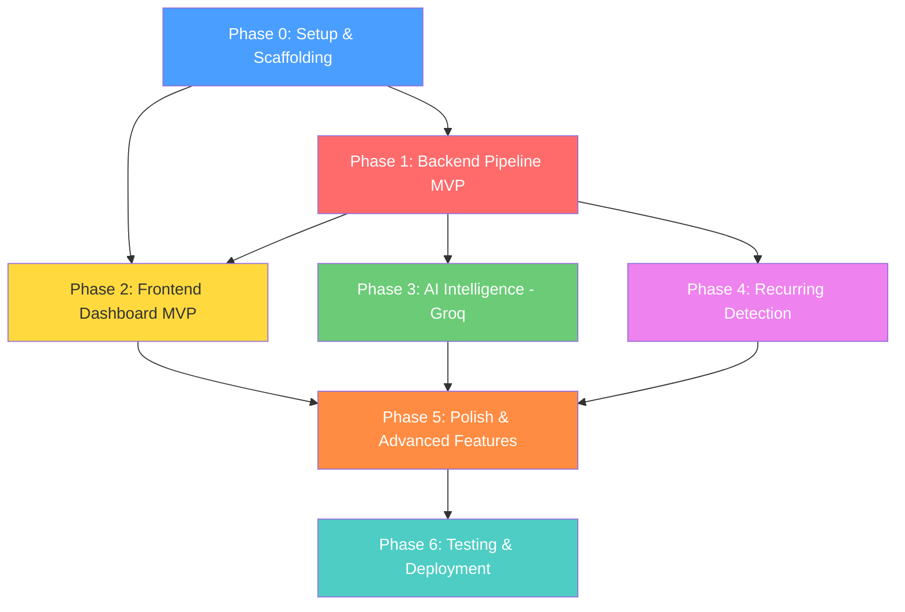

# RupeeRadar — Phase-Wise Implementation Plan

This document provides a detailed, step-by-step implementation plan for RupeeRadar, broken down into phases, tasks, and subtasks. It is derived from [architecture.md](file:///d:/Rupee_Radar/docs/architecture.md) and follows the 7-stage processing pipeline defined there.

---

## Overview

| Phase | Name | Focus | Estimated Effort |
|-------|------|-------|-----------------|
| **Phase 0** | Project Setup & Scaffolding | Boilerplate, tooling, dev environment | 1–2 hours |
| **Phase 1** | Backend Pipeline (MVP) | Parse → Clean → Categorize → Metrics → Insights | 6–8 hours |
| **Phase 2** | Frontend Dashboard (MVP) | Upload UI → Dashboard with charts & tables | 5–7 hours |
| **Phase 3** | AI Intelligence & Hosting Setup | Quota-aware Groq fallback + Railway/Vercel deployment path | 5–7 hours |
| **Phase 4** | Recurring Detection | Subscription/EMI/SIP detection engine | 3–4 hours |
| **Phase 5** | Polish & Advanced Features | Category override, report export, 2nd bank format | 4–6 hours |
| **Phase 6** | Testing & Deployment | Tests, Docker, deployment, final QA | 3–4 hours |

**Total estimated effort: 27–38 hours**

---

## Phase 0 — Project Setup & Scaffolding

> **Goal:** Set up the project skeleton, development environment, and tooling so that all subsequent phases can build incrementally.

### 0.1 Initialize Repository Structure

- [x] Create the root project directory layout per [architecture.md §15](file:///d:/Rupee_Radar/docs/architecture.md#L914):
  ```
  rupee-radar/
  ├── docs/
  ├── backend/
  │   ├── app/
  │   │   ├── api/routes/
  │   │   ├── parsers/
  │   │   ├── pipeline/
  │   │   ├── models/
  │   │   ├── services/
  │   │   └── utils/
  │   └── tests/fixtures/
  └── frontend/
      └── src/
          ├── components/
          ├── pages/
          ├── api/
          ├── types/
          └── utils/
  ```
- [x] Create `.gitignore` (Python + Node + IDE + `.env` exclusions)
- [x] Create `README.md` with project overview and setup instructions

### 0.2 Backend Foundation

- [x] Create `backend/requirements.txt` with initial dependencies:
  ```
  fastapi>=0.104.0
  uvicorn[standard]>=0.24.0
  python-multipart>=0.0.6
  pandas>=2.1.0
  sqlalchemy>=2.0.0
  pydantic>=2.5.0
  python-dotenv>=1.0.0
  groq>=0.4.0
  ```
- [x] Create `backend/app/main.py` — FastAPI application entry point with:
  - CORS middleware configured from `CORS_ORIGINS` env var
  - Root health-check endpoint (`GET /` → `{"status": "ok"}`)
  - API router mounted at `/api/v1`
- [x] Create `backend/app/config.py` — Load environment variables via `pydantic-settings` or `python-dotenv`:
  - `DATABASE_URL`, `GROQ_API_KEY`, `GROQ_MODEL`, `SESSION_TTL_HOURS`, `MAX_UPLOAD_SIZE_MB`, `CORS_ORIGINS`
- [x] Create `backend/.env.example` with all env var templates
- [x] Verify backend starts: `uvicorn app.main:app --reload --port 8000`

### 0.3 Database Setup

- [x] Create `backend/app/models/database.py` — SQLAlchemy engine + session factory for SQLite
- [x] Create `backend/app/models/schemas.py` — Pydantic models for all entities:
  - `UploadSessionCreate`, `UploadSessionResponse`
  - `TransactionResponse`, `TransactionUpdate` (for category override)
  - `RecurringGroupResponse`
  - `AnalysisResultResponse`
  - `InsightResponse`
- [x] Implement SQLAlchemy ORM models matching the [database schema](file:///d:/Rupee_Radar/docs/architecture.md#L627):
  - `upload_sessions`, `transactions`, `recurring_groups`, `analysis_results`
- [x] Add table creation on app startup (`create_all`)
- [x] Verify: DB file created, tables exist

### 0.4 Frontend Foundation

- [x] Scaffold React + TypeScript project with Vite:
  ```bash
  npx -y create-vite@latest ./ --template react-ts
  ```
- [x] Install dependencies:
  ```bash
  npm install react-router-dom @tanstack/react-query axios recharts
  npm install -D tailwindcss @tailwindcss/vite
  ```
- [x] Configure Tailwind CSS
- [x] Configure Vite proxy to forward `/api` requests to `localhost:8000`
- [x] Create `src/types/index.ts` — TypeScript interfaces matching backend schemas
- [x] Create `src/api/client.ts` — Axios instance + API helper functions (stubs)
- [x] Create placeholder pages: `LandingPage.tsx`, `AnalysisPage.tsx`
- [x] Set up React Router with routes: `/` and `/analysis/:sessionId`
- [x] Verify frontend starts: `npm run dev` → loads landing page

### 0.5 Verify End-to-End Connectivity

- [x] Frontend fetches `GET /` from backend and displays health status
- [x] Both dev servers run simultaneously without port conflicts
- [x] CORS allows frontend origin

**Phase 0 exit criteria:** Both servers start, health check passes from browser, DB tables created. [PASSED]

---

## Phase 1 — Backend Pipeline (MVP)

> **Goal:** Implement the core backend pipeline: upload a CSV → parse → clean → categorize (rules only) → compute metrics → generate template insights. No LLM, no recurring detection yet.

### 1.1 File Upload Endpoint (Stage 1)

**File:** `backend/app/api/routes/upload.py`

- [x] Implement `POST /api/v1/upload`:
  - Accept multipart file upload + optional `bank_hint` field
  - Validate file type (`.csv` only for Phase 1)
  - Validate file size (≤ `MAX_UPLOAD_SIZE_MB`)
  - Reject empty files with clear error: `"No data found in the uploaded file."`
  - Create `UploadSession` record with `status = "pending"`
  - Save file temporarily to `backend/uploads/{session_id}.csv`
  - Return `200/202 { session_id, status: ... }`
- [x] Implement `GET /api/v1/sessions/{id}`:
  - Return session status and metadata
  - Return `404` if session not found
- [x] Create `backend/uploads/` directory (gitignored)

### 1.2 CSV Parser (Stage 1)

**Files:** `backend/app/parsers/base.py`, `backend/app/parsers/generic_csv.py`

- [x] Define `StatementParser` protocol in `base.py`:
  ```python
  class StatementParser(Protocol):
      def can_parse(self, file_path: str, bank_hint: str | None) -> bool: ...
      def parse(self, file_path: str) -> list[dict]: ...
  ```
- [x] Implement `GenericCSVParser` in `generic_csv.py`:
  - Read CSV with pandas (`pd.read_csv` with encoding detection)
  - Auto-detect columns by header name matching:
    - Date columns: `date`, `transaction date`, `txn date`, `value date`
    - Description columns: `description`, `narration`, `particulars`, `remarks`
    - Amount columns: `amount`, `debit`, `credit`, `withdrawal`, `deposit`
    - Balance columns: `balance`, `closing balance`
  - Handle both single-amount (signed) and split-column (debit/credit) formats
  - Parse dates: try multiple formats (`DD/MM/YYYY`, `DD-MM-YYYY`, `YYYY-MM-DD`, `DD/MM/YY`)
  - Emit canonical transaction schema: `{ date, description_raw, amount, type, balance }`
  - Skip unparseable rows; collect warnings
  - Detect and flag duplicate rows via `(date, amount, description_raw)` hash
- [x] Implement parser registry: try each parser's `can_parse()`, use first match
- [x] Create test fixture: `tests/fixtures/generic_sample.csv` with ~20 realistic Indian transactions

### 1.3 Transaction Cleaner (Stage 2)

**File:** `backend/app/pipeline/cleaner.py`

- [x] Implement `clean_transactions(raw_txns: list[dict]) -> list[dict]`:
  - **Strip noise** from descriptions:
    - Remove UPI prefixes: `UPI/`, `UPI-`, `UPI/DR/`, `UPI/CR/`
    - Remove NEFT/IMPS prefixes and reference numbers
    - Remove trailing reference IDs (numeric sequences > 6 digits)
    - Strip extra whitespace, normalize to uppercase
  - **Merchant extraction** via regex + known merchant dictionary:
    - Extract recognizable merchant name from cleaned string
  - **Payment mode detection:**
    - Detect UPI, NEFT, IMPS, card, ATM, cash from description keywords
    - Store in `metadata.payment_mode`
  - **Amount sign correction:**
    - Ensure debits are negative, credits are positive
  - **Date normalization:**
    - Convert all dates to ISO 8601 (`YYYY-MM-DD`)
  - Output: enriched transaction dicts with `description_clean`, `payment_mode`

### 1.4 Merchant Dictionary

**File:** `backend/app/utils/merchant_dict.py`

- [x] Create a curated dictionary of 50+ common Indian merchants → categories:
  ```python
  MERCHANT_CATEGORIES = {
      "swiggy": "Food",
      "zomato": "Food",
      "dominos": "Food",
      "mcdonald": "Food",
      "starbucks": "Food",
      "uber": "Travel",
      "ola": "Travel",
      "irctc": "Travel",
      "makemytrip": "Travel",
      "amazon": "Shopping",
      "flipkart": "Shopping",
      "myntra": "Shopping",
      "netflix": "Subscriptions",
      "spotify": "Subscriptions",
      "youtube": "Subscriptions",
      "hotstar": "Subscriptions",
      "zerodha": "Investments",
      "groww": "Investments",
      # ... 30+ more entries
  }
  ```
- [x] Implement fuzzy lookup function: `find_merchant(description_clean) -> (merchant, category) | None`

### 1.5 Rule-Based Categorizer (Stage 3 — Rules Only)

**File:** `backend/app/pipeline/categorizer.py`

- [x] Implement `categorize_transactions(txns: list[dict]) -> list[dict]`:
  - **Tier 1 — Rule engine:**
    - Pattern-match `description_clean` against keyword rules:
      - `SALARY`, `NEFT CREDIT SALARY` → `Salary` (confidence: 0.95)
      - `EMI`, `HOME LOAN`, `LOAN` → `EMI` (confidence: 0.90)
      - `RENT`, `HOUSE RENT` → `Rent` (confidence: 0.90)
      - `SIP`, `MUTUAL FUND` → `Investments` (confidence: 0.90)
      - `ELECTRICITY`, `WATER`, `GAS`, `BROADBAND` → `Bills` (confidence: 0.85)
    - Credit transactions with no keyword match → check if large amount → likely `Salary`
  - **Tier 2 — Merchant dictionary lookup:**
    - Look up `description_clean` against `MERCHANT_CATEGORIES`
    - Confidence: 0.85 for exact match, 0.70 for fuzzy match
  - **Tier 4 — Fallback:**
    - Unmatched transactions → `Other` with confidence 0.0
  - Output: transactions with `category`, `category_confidence` fields

### 1.6 Metrics Calculator (Stage 5)

**File:** `backend/app/pipeline/metrics.py`

- [x] Implement `compute_metrics(txns: list[dict]) -> dict`:
  - `total_income`: sum of credits
  - `total_spend`: absolute sum of debits
  - `savings`: income − spend
  - `savings_rate`: (savings / income) × 100 (handle division by zero)
  - `transaction_count`: total number of transactions
  - `date_range`: `{ from, to }` from min/max dates
  - `top_categories`: debit totals grouped by category, sorted descending, with percentages
  - `biggest_transactions`: top 5 largest debits with description, amount, date
  - `monthly_spend`: debits grouped by `YYYY-MM`, sorted chronologically
  - `category_breakdown`: all categories with counts and totals

### 1.7 Template Insight Generator (Stage 6 — Templates Only)

**File:** `backend/app/pipeline/insights.py`

- [x] Implement `generate_insights(metrics: dict, txns: list[dict]) -> list[str]`:
  - Generate ≥ 3 insights from templates:
    1. **Top category:** "You spent ₹{amount} on {category} — your largest spending category."
    2. **Biggest transaction:** "Your biggest transaction was ₹{amount} to {merchant} on {date}."
    3. **Savings rate:** "Your savings rate is {rate}% — you saved ₹{savings} this period."
    4. **Transaction frequency:** "You made {count} transactions averaging ₹{avg} each."
    5. **Monthly comparison:** "Your highest spending month was {month} at ₹{amount}." (if multi-month data)
  - Format all amounts with Indian currency notation (₹ with commas: ₹1,25,000)
  - Only generate insights where data is sufficient (e.g., skip monthly comparison for single-month data)

### 1.8 Pipeline Orchestrator

**File:** `backend/app/services/pipeline.py`

- [x] Implement `run_pipeline(session_id: str, file_path: str, bank_hint: str | None) -> None`:
  - Update session status at each stage: `parsing` → `processing` → `ready` (or `failed`)
  - **Step 1:** Select parser → parse file → get raw transactions
  - **Step 2:** Clean transactions
  - **Step 3:** Categorize transactions (rules only for Phase 1)
  - **Step 4:** _(Skip recurring detection — Phase 4)_
  - **Step 5:** Compute metrics
  - **Step 6:** Generate template insights
  - **Step 7:** Save all data to database:
    - Insert transactions into `transactions` table
    - Insert analysis result into `analysis_results` table
    - Update session `status = "ready"`, `row_count = N`
  - Delete raw uploaded file after successful parse
  - On any error: set session `status = "failed"`, `error_message = "..."`
- [x] Call `run_pipeline` synchronously from `POST /upload` after file validation

### 1.9 Data Retrieval Endpoints

**Files:** `backend/app/api/routes/transactions.py`, `analytics.py`, `insights.py`

- [x] Implement `GET /api/v1/sessions/{id}/transactions`:
  - Query transactions by `session_id`
  - Support pagination: `?page=1&per_page=50`
  - Support filter: `?category=Food`
  - Support sort: `?sort_by=date&order=desc`
  - Return `{ data: [...], total, page, per_page }`
- [x] Implement `GET /api/v1/sessions/{id}/analytics`:
  - Return `AnalysisResult` for the session
  - Return `404` if session not found or not ready
- [x] Implement `GET /api/v1/sessions/{id}/insights`:
  - Return `{ insights: [...] }` from analysis results

### 1.10 Phase 1 Validation

- [x] Test with fixture CSV: upload → parse → clean → categorize → metrics → insights
- [x] Verify all API endpoints return correct data
- [x] Verify error handling: empty file, wrong format, malformed CSV
- [x] Check that raw file is deleted after processing

**Phase 1 exit criteria:** Upload a CSV via API → get back cleaned, categorized transactions + metrics + 3 insights. [PASSED]

---

## Phase 2 — Frontend Dashboard (MVP)

> **Goal:** Build the user-facing landing page and analysis dashboard. Users can upload a file and see their financial analysis.

### 2.1 Landing Page

**File:** `frontend/src/pages/LandingPage.tsx`

- [ ] Design hero section:
  - App name "RupeeRadar" with tagline
  - Brief description of what the app does
  - Visual indicator (icon or illustration)
- [ ] Implement `FileUpload` component:
  - Drag-and-drop zone with visual feedback
  - Click to browse fallback
  - Accepted format hints: "Upload your bank statement (CSV)"
  - File size limit display (10 MB)
  - Upload progress indicator
  - Error display for invalid files
- [ ] On successful upload:
  - Receive `session_id` from API
  - Navigate to `/analysis/{session_id}`

### 2.2 API Client Layer

**File:** `frontend/src/api/client.ts`

- [ ] Implement API helper functions using Axios:
  ```typescript
  uploadStatement(file: File, bankHint?: string): Promise<UploadResponse>
  getSession(sessionId: string): Promise<SessionResponse>
  getTransactions(sessionId: string, params?: QueryParams): Promise<TransactionsResponse>
  getAnalytics(sessionId: string): Promise<AnalyticsResponse>
  getInsights(sessionId: string): Promise<InsightsResponse>
  getRecurring(sessionId: string): Promise<RecurringResponse>
  updateTransactionCategory(sessionId: string, txnId: number, category: string): Promise<Transaction>
  ```
- [ ] Add error handling: network errors, 404s, 500s → user-friendly messages
- [ ] Set up React Query provider in `App.tsx`

### 2.3 Processing Status View

**File:** `frontend/src/components/ProcessingStatus.tsx`

- [ ] Poll `GET /sessions/{id}` every 2 seconds while `status !== "ready"`
- [ ] Display pipeline progress stages:
  - ⏳ Uploading → ⏳ Parsing → ⏳ Categorizing → ✅ Ready
- [ ] Show error state if `status === "failed"` with `error_message`
- [ ] Transition to dashboard when `status === "ready"`

### 2.4 Summary Cards

**File:** `frontend/src/components/SummaryCards.tsx`

- [ ] Fetch analytics data via `useQuery`
- [ ] Display 4 metric cards in a responsive grid:
  - 💰 **Total Income** — formatted with ₹ and Indian comma notation
  - 💸 **Total Spend** — with percentage of income
  - 🏦 **Savings** — with color indicator (green if positive, red if negative)
  - 📊 **Savings Rate** — percentage with visual gauge or bar
- [ ] Add subtle animations on card appearance (fade-in or slide-up)

### 2.5 Category Breakdown Chart

**File:** `frontend/src/components/CategoryChart.tsx`

- [ ] Implement donut/pie chart using Recharts:
  - Each slice = one category
  - Color-coded with consistent category colors
  - Show amount + percentage on hover/tooltip
  - Legend with category names and totals
- [ ] Alternative bar chart toggle for accessibility

### 2.6 Transaction Table

**File:** `frontend/src/components/TransactionTable.tsx`

- [ ] Fetch paginated transactions via `useQuery`
- [ ] Display columns: Date, Description (clean), Amount, Category, Type
- [ ] Show `description_raw` on hover or expand for transparency
- [ ] Category displayed as a colored badge
- [ ] Sorting: clickable column headers (date, amount, category)
- [ ] Filtering: category dropdown filter, search by description
- [ ] Pagination controls at the bottom
- [ ] Color-code: debits in red, credits in green
- [ ] Indian currency formatting: ₹1,25,000.00

### 2.7 Insight Cards

**File:** `frontend/src/components/InsightCards.tsx`

- [ ] Fetch insights via `useQuery`
- [ ] Display each insight as a styled card:
  - Icon matching insight type (💰, 📈, 🔄, etc.)
  - Insight text with highlighted amounts
  - Subtle background color or gradient
- [ ] Minimum 3 insight cards displayed

### 2.8 Analysis Page Assembly

**File:** `frontend/src/pages/AnalysisPage.tsx`

- [ ] Assemble all components in a scrollable layout:
  1. `ProcessingStatus` (shown while loading)
  2. `SummaryCards` (top row)
  3. `CategoryChart` (left) + quick stats (right)
  4. `TransactionTable` (full width)
  5. `InsightCards` (bottom section)
- [ ] Responsive layout: stack vertically on mobile
- [ ] Add "Upload Another" button to return to landing page

### 2.9 Styling & Design System

- [ ] Define consistent color palette:
  - Category colors (Food = orange, Travel = blue, Shopping = purple, etc.)
  - Semantic colors (income = green, expense = red, neutral = gray)
  - Background, surface, and text colors for dark/light themes
- [ ] Typography: use Google Font (Inter or similar)
- [ ] Consistent spacing, border radius, shadows
- [ ] Smooth transitions and micro-animations

### 2.10 Phase 2 Validation

- [ ] Full user flow: Open app → drag CSV → see dashboard with cards, chart, table, insights
- [ ] Test error states: invalid file, empty file, network error
- [ ] Test responsiveness: desktop, tablet, mobile widths
- [ ] Verify data accuracy: amounts match CSV input

**Phase 2 exit criteria:** User can upload a CSV and see a complete dashboard with summary, chart, table, and insights.

---

## Phase 3 — AI Intelligence & Hosting Setup

> **Goal:** Add quota-aware LLM categorization for transactions the rule engine can't handle, generate richer narrative insights, and establish Railway (backend) and Vercel (frontend) as the hosted deployment targets.

### 3.1 Groq Client Service

**File:** `backend/app/services/groq_client.py`

- [ ] Implement `GroqClient` class:
  - Initialize with `GROQ_API_KEY` and `GROQ_MODEL` from config
  - Handle API key missing gracefully (log warning, return empty results)
- [ ] Implement `categorize_batch(transactions: list[dict]) -> list[dict]`:
  - Accept list of `{ id, description_clean, amount, type }`
  - Batch by estimated prompt size, not just transaction count; keep each request small enough to fit the configured token budget
  - Construct prompt with:
    - System message: "You are a financial transaction categorizer for Indian bank statements..."
    - Category enum: Food, Travel, Shopping, Bills, EMI, Subscriptions, Salary, Rent, Investments, Other
    - Few-shot examples for messy UPI strings
    - Request structured JSON output
  - Parse response, extract `{ id, category, confidence }` for each transaction
  - Handle malformed responses: retry once, then skip
  - **Privacy:** Never send account numbers, balances, or session IDs
  - Truncate/normalize descriptions and cap the number of records sent; use rule/dictionary results for any remainder
- [ ] Implement `generate_narrative_insights(metrics: dict) -> list[str]`:
  - Send aggregated metrics (not raw transactions) to Groq
  - Prompt: "Given this spending summary for an Indian professional, generate 2–3 actionable insights..."
  - Parse and return insight strings
  - Handle unavailability: return empty list
- [ ] Use the configured model `llama-3.3-70b-versatile`; keep the API key server-side and never expose it to Vite/client code or logs

### 3.2 Groq quota and resilience controls

**Files:** `backend/app/services/groq_client.py`, `backend/app/config.py`, quota tracking service/storage

- [ ] Enforce the account limits supplied for `llama-3.3-70b-versatile` across categorization and insight requests:
  - 30 requests per minute
  - 1,000 tokens per minute
  - 12,000 requests per day
  - 100,000 tokens per day
- [ ] Add configurable application budgets below provider ceilings (recommended starting budget: 24 RPM, 800 TPM, 10,800 RPD, 90,000 TPD) to leave headroom for accounting variance and any other use of the same Groq key.
- [ ] Track request counts over a rolling 60-second window and daily request/token usage in one shared quota coordinator used by every Groq call path.
- [ ] Estimate and reserve prompt plus maximum completion tokens before sending a request; reconcile the reservation against returned usage after completion. Do not send a request that would exceed either the per-minute or daily token budget.
- [ ] Serialize or queue calls when needed to protect the 1,000 TPM ceiling; bound prompt/output sizes so one request cannot consume the entire minute's budget.
- [ ] Persist daily quota usage with the application data so restarts do not reset the local daily budget. Configure the hosted backend for one Railway replica while using local SQLite-backed coordination; if scaling to multiple replicas, move quota coordination to a shared atomic store before scaling.
- [ ] Treat HTTP 429 and timeouts as quota/availability failures: honor `Retry-After` when present, otherwise use bounded backoff, and allow at most one retry only when the shared limiter re-reserves the request. Do not blindly retry.
- [ ] On quota exhaustion or provider failure, skip optional AI work and preserve the rules/dictionary categorization and template insights. A Groq error must never fail the upload pipeline.
- [ ] Ensure Phase 2 remains Groq-free when AI is disabled; existing rule-based upload/dashboard behavior must remain available without an API key.

### 3.3 Enhance Categorizer with LLM Fallback

**File:** `backend/app/pipeline/categorizer.py`

- [ ] Update `categorize_transactions()` to include Tier 3 — LLM:
  - After rule engine + merchant dictionary, collect unmatched transactions
  - If unmatched count > 0 and Groq API key is configured:
    - Send unmatched batch to `GroqClient.categorize_batch()`
    - Merge LLM results back into transaction list
    - Apply confidence threshold: < 0.6 → keep as `Other`
  - If Groq unavailable: gracefully degrade (all unmatched stay `Other`)
- [ ] Log: count of rule-matched, dictionary-matched, LLM-matched, and fallback transactions

### 3.4 Enhance Insights with LLM

**File:** `backend/app/pipeline/insights.py`

- [ ] Update `generate_insights()`:
  - First generate all template insights (Tier 1)
  - Then call `GroqClient.generate_narrative_insights()` with metrics summary
  - Append LLM insights to the list (if available)
  - Ensure total ≥ 3 insights even without LLM
  - Tag each insight with source: `"template"` or `"ai"`

### 3.5 Railway backend and Vercel frontend deployment

**Files:** deployment configuration/documentation and environment templates

- [ ] Configure Railway to deploy the FastAPI service from the `backend/` root:
  - Install dependencies from `requirements.txt`
  - Start with `uvicorn app.main:app --host 0.0.0.0 --port $PORT`
  - Set `GROQ_API_KEY` as a Railway secret and `GROQ_MODEL=llama-3.3-70b-versatile`; never commit secrets
  - Set `CORS_ORIGINS` to the exact deployed Vercel origin(s), without a wildcard in production
  - Set `DATABASE_URL` to a durable database location. For SQLite, mount a Railway volume at the database path and retain a single replica; alternatively use a managed PostgreSQL database. Do not rely on Railway's ephemeral filesystem for sessions/results.
  - Keep transient uploaded CSV files in temporary storage and delete them after processing, including on error paths
  - Configure and verify the Railway health check against `/` or `/api/v1/health`
- [ ] Configure Vercel to deploy the `frontend/` root using `npm run build` and the `dist` output:
  - Set `VITE_API_BASE_URL=https://<railway-service-domain>/api/v1`
  - Add a Vercel SPA rewrite so direct navigation/refresh on `/analysis/:sessionId` serves `index.html`
  - Keep all secrets out of `VITE_*` variables; only the public API base URL belongs in the frontend environment
- [ ] Add deployment instructions and required environment variables to the project README and `.env.example` files, using placeholders only.
- [ ] Deploy a staging instance and verify browser-origin CORS, health checks, CSV upload, processing completion, and dashboard API calls end-to-end.

### 3.6 Phase 3 Validation

- [ ] Test with CSV containing ambiguous transactions (e.g., "POS PURCHASE BANGALORE")
- [ ] Verify LLM categorization improves coverage vs. rules-only
- [ ] Verify graceful degradation when `GROQ_API_KEY` is not set
- [ ] Verify LLM insights are relevant and cite real amounts
- [ ] Check that no sensitive data appears in Groq requests (inspect logs)
- [ ] Unit-test quota accounting at the minute and daily request/token boundaries, including concurrent callers, restart persistence, reconciliation, and exhausted-budget behavior
- [ ] Verify the configured application budgets never exceed 24 RPM, 800 TPM, 10,800 RPD, or 90,000 TPD, and configured hard ceilings do not exceed the supplied Groq limits
- [ ] Verify upload succeeds with deterministic fallbacks when quota is exhausted, Groq returns 429/5xx, or Groq times out
- [ ] Verify deployed Vercel origin can reach the Railway API, including a direct browser refresh at `/analysis/{session_id}`

**Phase 3 exit criteria:** Groq categorization and insights are available within enforced quota budgets and fail safely to deterministic outputs; a Railway backend and Vercel frontend staging deployment passes an end-to-end upload/dashboard smoke test.

---

## Phase 4 — Recurring Payment Detection

> **Goal:** Implement the recurring payment detection engine (Stage 4) and display results in the frontend.

### 4.1 Recurring Detection Engine

**File:** `backend/app/pipeline/recurring.py`

- [ ] Implement `detect_recurring(txns: list[dict]) -> list[RecurringGroup]`:
  - **Step 1 — Group by similar description:**
    - Normalize `description_clean` to tokens
    - Group using token overlap (≥ 60% shared tokens) or exact `merchant` match
    - Only consider debit transactions
  - **Step 2 — Validate each group:**
    - Require ≥ 2 occurrences
    - Check amount consistency: within ±5% or ±₹50 of median
    - Compute intervals between consecutive transactions (sorted by date)
    - Detect frequency:
      - Weekly: 6–8 day intervals
      - Monthly: 28–32 day intervals
      - Quarterly: 88–95 day intervals
      - Yearly: 360–370 day intervals
      - Unknown: inconsistent intervals but similar amounts
  - **Step 3 — Label and enrich:**
    - Set `label` from merchant name or most common keyword
    - Set `typical_amount` as median of group amounts
    - Set `last_seen_date` as most recent transaction date
    - Set `confidence` based on amount variance + interval consistency
  - **Step 4 — Category override:**
    - If label matches EMI/loan patterns → override category to `EMI`
    - If label matches SIP/mutual fund → override to `Investments`
    - If label matches subscription keywords → override to `Subscriptions`
  - Output: list of `RecurringGroup` records

### 4.2 Integrate into Pipeline

**File:** `backend/app/services/pipeline.py`

- [ ] Add Stage 4 call between categorization and metrics:
  - Call `detect_recurring(cleaned_categorized_txns)`
  - Save `RecurringGroup` records to database
  - Update `is_recurring` and `recurring_group_id` on matched transactions
  - Include recurring data in metrics: `recurring_total`, `recurring_count`
- [ ] Add recurring-specific insight template:
  - "We detected {count} recurring payments totalling ₹{total}/month (e.g., {examples})."

### 4.3 Recurring API Endpoint

**File:** `backend/app/api/routes/recurring.py`

- [ ] Implement `GET /api/v1/sessions/{id}/recurring`:
  - Return list of `RecurringGroup` objects with linked transactions
  - Include: label, category, frequency, typical_amount, last_seen_date, confidence, transaction count

### 4.4 Frontend — Recurring Panel

**File:** `frontend/src/components/RecurringList.tsx`

- [ ] Fetch recurring groups via `useQuery`
- [ ] Display as card list:
  - Each card shows: merchant/label, category badge, frequency, amount, last seen date
  - Visual indicator for frequency (🔄 monthly, 📅 yearly, etc.)
  - Confidence indicator (high/medium/low)
- [ ] Add to `AnalysisPage` between insights and transaction table

### 4.5 Phase 4 Validation

- [ ] Test with CSV containing:
  - Monthly rent payments (same amount, ~30-day intervals)
  - Netflix/Spotify subscriptions
  - EMI payments (exact same amount monthly)
  - Non-recurring similar descriptions (should NOT be grouped)
- [ ] Verify `is_recurring` flags on transactions
- [ ] Verify recurring panel displays correctly in UI
- [ ] Verify recurring insight generated

**Phase 4 exit criteria:** Recurring payments detected accurately; displayed in UI with frequency/amount; recurring insight generated.

---

## Phase 5 — Polish & Advanced Features

> **Goal:** Add quality-of-life features: category override, monthly trend chart, report export, second bank format, and overall UI polish.

### 5.1 Category Override (User Correction)

**Backend — File:** `backend/app/api/routes/transactions.py`

- [ ] Implement `PATCH /api/v1/sessions/{id}/transactions/{txn_id}`:
  - Accept `{ category: "Food" }` in request body
  - Validate category is in the allowed enum
  - Update transaction's category, set `category_confidence = 1.0` (user override)
  - Recompute and save updated metrics + insights for the session
  - Return updated transaction

**Frontend — File:** `frontend/src/components/CategoryOverride.tsx`

- [ ] Add inline dropdown in `TransactionTable` rows:
  - Click on category badge → dropdown with all 10 categories
  - On selection → call PATCH endpoint → optimistic UI update
  - Show confirmation toast on success

### 5.2 Monthly Trend Chart

**File:** `frontend/src/components/MonthlyTrendChart.tsx`

- [ ] Implement line/bar chart using Recharts:
  - X-axis: months (from `monthly_spend` in analytics)
  - Y-axis: amount in ₹
  - Bar chart for spending by month
  - Optional line overlay for income (if multi-month)
  - Tooltip showing exact amount for each month
- [ ] Only render if data spans ≥ 2 months
- [ ] Add to `AnalysisPage` after category chart

### 5.3 Second Bank Format Parser

**File:** `backend/app/parsers/hdfc_csv.py` (or `icici_csv.py`)

- [ ] Implement `HDFCCSVParser` (or `ICICICSVParser`):
  - Detect HDFC format by header pattern (e.g., specific column names)
  - Handle HDFC-specific quirks:
    - Date format variations
    - Separate "Withdrawal Amt" and "Deposit Amt" columns
    - "Narration" column for descriptions
    - "Closing Balance" column
  - Map to canonical transaction schema
- [ ] Register in parser registry (tried before generic parser)
- [ ] Add test fixture: `tests/fixtures/hdfc_sample.csv`

### 5.4 Report Export

**Backend — File:** `backend/app/services/report_generator.py`

- [ ] Implement `generate_report_html(session_id: str) -> str`:
  - Render an HTML report with inline CSS (no external dependencies):
    - Header with "RupeeRadar Financial Summary" + date range
    - Summary metrics table
    - Category breakdown (simple bar chart via CSS or inline SVG)
    - Top 10 transactions table
    - Recurring payments list
    - Insights section
    - Footer with timestamp and disclaimer
  - Optimized for print: A4, clean typography

**Backend — File:** `backend/app/api/routes/report.py`

- [ ] Implement `GET /api/v1/sessions/{id}/report`:
  - Return HTML report with `Content-Type: text/html`
  - Support `?format=pdf` (optional, via weasyprint if installed)

**Frontend — File:** `frontend/src/components/ReportExport.tsx`

- [ ] Add "Download Report" button:
  - Opens report in new tab (HTML)
  - Browser print dialog for PDF (Ctrl+P)
- [ ] Add to `AnalysisPage` as a prominent action button

### 5.5 Session Cleanup

**File:** `backend/app/api/routes/sessions.py`

- [ ] Implement `DELETE /api/v1/sessions/{id}`:
  - Delete session + all related data (cascade)
  - Delete any remaining uploaded files
  - Return `204 No Content`
- [ ] Implement TTL cleanup (optional background task):
  - On each request or periodic check: delete sessions where `expires_at < now()`

### 5.6 UI Polish

- [ ] **Empty states:** Helpful messages when no data (e.g., "No recurring payments detected")
- [ ] **Loading skeletons:** Animated placeholders while data loads
- [ ] **Error boundaries:** Catch component errors, show friendly fallback
- [ ] **Animations:** Fade-in cards, smooth chart transitions
- [ ] **Responsive final pass:** Test and fix layout on 320px–1920px widths
- [ ] **Favicon and meta tags:** Title, description, OG tags for sharing
- [ ] **Dark mode support** (optional but recommended)

### 5.7 Phase 5 Validation

- [ ] Category override: change a transaction → metrics update in real time
- [ ] Monthly trend chart renders correctly for multi-month data
- [ ] HDFC CSV parses correctly alongside generic format
- [ ] Report opens as clean, printable HTML
- [ ] Session delete removes all data
- [ ] UI is polished, no broken layouts or missing states

**Phase 5 exit criteria:** All quality features work; UI is production-ready; report is downloadable.

---

## Phase 6 — Testing & Deployment

> **Goal:** Write tests, containerize the application, deploy, and do final QA.

### 6.1 Backend Unit Tests

**Directory:** `backend/tests/`

- [ ] `test_parsers.py`:
  - Test generic CSV parser with multiple formats
  - Test HDFC parser with bank-specific sample
  - Test empty file, malformed CSV, missing columns
  - Test date parsing with various formats
  - Test duplicate detection
- [ ] `test_cleaner.py`:
  - Test UPI description cleaning
  - Test NEFT/IMPS cleaning
  - Test merchant extraction
  - Test payment mode detection
  - Test amount sign correction
- [ ] `test_categorizer.py`:
  - Test rule engine matches (each category)
  - Test merchant dictionary lookups
  - Test fallback to `Other`
  - Test confidence scores
- [ ] `test_recurring.py`:
  - Test monthly recurring detection
  - Test amount tolerance
  - Test minimum 2-occurrence threshold
  - Test non-recurring similar descriptions
- [ ] `test_metrics.py`:
  - Test income/spend/savings calculation
  - Test category breakdown
  - Test biggest transaction identification
  - Test edge cases: zero income, single transaction, all same category

### 6.2 Integration Tests

- [ ] `test_pipeline.py`:
  - Upload sample CSV → verify full pipeline output matches expected golden file
  - Test with messy UPI strings
  - Test with mixed credit/debit transactions
  - Test error handling: corrupt file mid-pipeline

### 6.3 Create Test Fixtures

**Directory:** `backend/tests/fixtures/`

- [ ] `generic_sample.csv` — 20 mixed transactions
- [ ] `hdfc_sample.csv` — HDFC-format transactions
- [ ] `messy_upi.csv` — Deliberately messy UPI descriptions
- [ ] `edge_cases.csv` — Zero amounts, very large amounts, single transaction, all same date
- [ ] `expected_output/` — Golden JSON files for each fixture

### 6.4 Docker Setup

- [ ] Create `backend/Dockerfile`:
  ```dockerfile
  FROM python:3.12-slim
  WORKDIR /app
  COPY requirements.txt .
  RUN pip install --no-cache-dir -r requirements.txt
  COPY app/ ./app/
  CMD ["uvicorn", "app.main:app", "--host", "0.0.0.0", "--port", "8000"]
  ```
- [ ] Create `frontend/Dockerfile`:
  ```dockerfile
  FROM node:20-slim AS build
  WORKDIR /app
  COPY package*.json ./
  RUN npm ci
  COPY . .
  RUN npm run build

  FROM nginx:alpine
  COPY --from=build /app/dist /usr/share/nginx/html
  COPY nginx.conf /etc/nginx/conf.d/default.conf
  ```
- [ ] Create `docker-compose.yml`:
  ```yaml
  services:
    api:
      build: ./backend
      ports: ["8000:8000"]
      env_file: .env
      volumes: ["./data:/app/data"]
    web:
      build: ./frontend
      ports: ["80:80"]
      depends_on: [api]
  ```
- [ ] Create `frontend/nginx.conf` — proxy `/api` to backend container
- [ ] Test: `docker compose up --build` → full app works

### 6.5 Deployment

- [ ] Deploy the backend to Railway and the frontend to Vercel (the Phase 3 staging smoke deployment establishes this path; this phase completes final deployment and release checks)
- [ ] Configure production environment variables and secrets; confirm the Vercel origin is included in Railway `CORS_ORIGINS`
- [ ] Confirm persistent storage/database configuration and backup/recovery expectations before accepting real user statements
- [ ] Deploy and verify:
  - Upload CSV → full analysis works
  - Direct navigation/refresh on `/analysis/{session_id}` works
  - Groq quota limits and deterministic fallbacks remain active in the deployed service
  - Report download works
  - Session cleanup works
- [ ] Add deployed URL to `README.md`

### 6.6 Final QA Checklist

- [ ] **Functional:**
  - [ ] Upload CSV → dashboard renders
  - [ ] Categories assigned correctly (rule + LLM)
  - [ ] Recurring payments detected
  - [ ] ≥ 3 insights displayed
  - [ ] Category override works
  - [ ] Report downloads as HTML
  - [ ] Session delete purges data
- [ ] **Edge cases:**
  - [ ] Empty file → clear error
  - [ ] Wrong file type → clear error
  - [ ] Single transaction → dashboard works
  - [ ] All same category → chart renders
  - [ ] No recurring payments → empty state shown
  - [ ] Groq API down → rules-only categorization works
- [ ] **UX:**
  - [ ] Loading states display correctly
  - [ ] Responsive on mobile
  - [ ] Amounts formatted with ₹ and Indian commas
  - [ ] Dates formatted consistently
- [ ] **Privacy:**
  - [ ] Raw file deleted after parse
  - [ ] No PII in console/logs
  - [ ] No financial data in localStorage

**Phase 6 exit criteria:** All tests pass, app deployed, full QA checklist green.

---

## Dependency Graph



### Critical Path

```
Phase 0 → Phase 1 → Phase 2 → Phase 5 → Phase 6
```

Phases 3 (Groq) and 4 (Recurring) can be developed **in parallel** after Phase 1, and are merged into Phase 5.

---

## Quick Reference: Files Created Per Phase

| Phase | Key Files Created |
|-------|------------------|
| **0** | `main.py`, `config.py`, `database.py`, `schemas.py`, `App.tsx`, `client.ts`, `.gitignore`, `README.md` |
| **1** | `upload.py`, `generic_csv.py`, `cleaner.py`, `categorizer.py`, `metrics.py`, `insights.py`, `pipeline.py`, `merchant_dict.py` |
| **2** | `LandingPage.tsx`, `AnalysisPage.tsx`, `FileUpload.tsx`, `SummaryCards.tsx`, `CategoryChart.tsx`, `TransactionTable.tsx`, `InsightCards.tsx`, `ProcessingStatus.tsx` |
| **3** | `groq_client.py`, shared Groq quota coordinator/storage (+ updates to `categorizer.py`, `insights.py`), Railway/Vercel staging configuration and deployment docs |
| **4** | `recurring.py`, `RecurringList.tsx` (+ updates to `pipeline.py`) |
| **5** | `hdfc_csv.py`, `report_generator.py`, `ReportExport.tsx`, `CategoryOverride.tsx`, `MonthlyTrendChart.tsx` |
| **6** | `Dockerfile` (×2), `docker-compose.yml`, `nginx.conf`, `test_*.py` files, fixtures |
